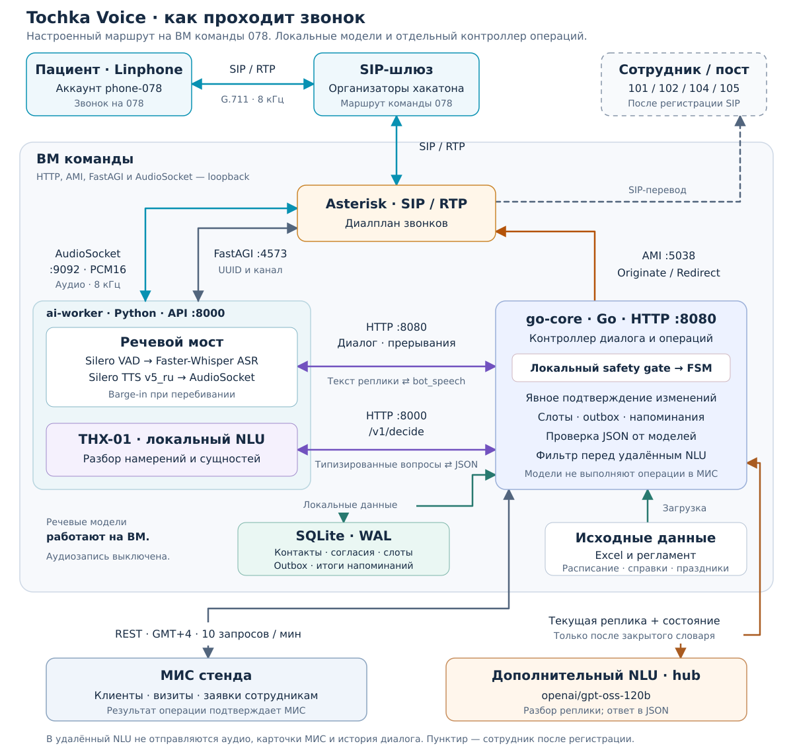

# Tochka Voice — Голосовая регистратура поликлиники № 7

<p align="center">
  
  
  
  
  <br>
  
  
  
  
  
</p>

<p align="center">
  <a href="docs/deployment.md">Запуск на ВМ</a> ·
  <a href="docs/architecture.md">Архитектура</a> ·
  <a href="docs/api.md">HTTP API</a> ·
  <a href="docs/acceptance.md">Протокол проверок</a>
</p>

Прототип для кейса DBI хакатона «Точка сборки»: входящие SIP-звонки, запись,
перенос и отмена приёма, справки по регламенту и исходящие напоминания.
Запрос перевода на сотрудника прерывает любой сценарий.

Последняя [проверка UX и отказоустойчивости](docs/polish-2026-10-20.md):
переспрос при неуверенном ASR, исправление данных голосом, проверка конфигурации
до обращения к МИС и повторяемые замеры задержек. В отчёте указаны код,
регрессии, команды воспроизведения и границы измерений.

---

## 🎯 Ключевые возможности

- **Запись, перенос и отмена** с идентификацией пациента и отдельным подтверждением; перенос сохраняет ID визита.
- **Голосовой SIP-диалог:** локальные VAD, ASR и TTS, приём речи во время ответа и barge-in при перебивании.
- **Безопасность каждой реплики:** экстренные обращения и просьба о человеке прерывают текущий сценарий.
- **Справки по исходным данным:** регламент поликлиники, каталог врачей и Excel организаторов.
- **Исходящие напоминания:** согласие на связь, проверка получателя, подтверждение, перенос или отмена приёма.
- **Контроль операций в Go:** модели разбирают речь; состояние, подтверждения, слоты и обращения к МИС контролирует FSM.

---

## 🖥️ Проверка на ВМ команды

Проект находится в `~/project`, сервисы —
`tochka-core`, `tochka-ai-worker` и `asterisk`. После входа по SSH:

```bash
cd ~/project
make health
systemctl is-active tochka-core tochka-ai-worker asterisk
sudo asterisk -rx 'pjsip show registrations'
```

Для живого звонка зарегистрируйте Linphone как `phone-078` на шлюзе
`84.54.59.198`, транспорт UDP, и наберите **078**. Пароль выдан организаторами
в приватном `~/SIP.md` на ВМ. У проекта нет браузерного интерфейса: проверяется
голосовой SIP-звонок. После отбоя ассистент перезванивает на
`PJSIP/<CALLERID(num)>@gateway`; это работает для `phone-NNN` и
`expert-1 … expert-6`, но не повторяется, если вызываемый не в сети.
Диалплан применяется через `sudo asterisk -rx "dialplan reload"`, без
перезапуска Asterisk. Подробная [инструкция для ВМ](docs/deployment.md) содержит
установку, автозапуск, перезапуск, проверки и восстановление.

---

## 🏗️ Архитектура системы

Asterisk передаёт метаданные звонка через FastAGI, а PCM16 8 кГц — через
AudioSocket в Python-сервис.
Локальные Silero VAD, Faster-Whisper и Silero TTS обслуживают речь.
Go-контроллер управляет диалогом и обращениями к МИС. Локальная THX-01 помогает
классифицировать реплики; резервный NLU подключается отдельно.

<p align="center">
  <a href="docs/assets/architecture.svg">
    
  </a>
</p>

На схеме показана конфигурация ВМ: NLU-шлюз `hub` включён явно, речевые модели
и THX-01 работают локально. **FastAGI передаёт метаданные, AudioSocket — звук,
AMI — команды исходящего звонка и перевода.** Ответ `bot_speech` возвращается
в речевой мост; синтез вызывает сам Python-сервис.

В локальном режиме софтфон подключается прямо к Asterisk, а без токена стенда
адаптер МИС хранит mock-клиентов и визиты в SQLite. Дополнительный NLU можно
отключить или заменить локальной Ollama / явно разрешённым Gemini.

---

## 📋 Сценарии и ограничения

| Код регламента | Поведение |
| --- | --- |
| С-01, С-02 | Прямая запись и направление; неподдерживаемые проверки выполняет сотрудник |
| С-03 | Перенос через PATCH существующего visit ID |
| С-04 | Отмена с сохранением истории МИС |
| С-05 | Проверка своей записи после идентификации |
| С-06 | Заявка на дом с адресом и причиной после подтверждения; визит утверждает сотрудник |
| С-07, С-08 | Расписание, справки и нормативные сроки анализов из исходных данных |
| С-10 | Напоминание, проверка получателя, подтверждение, перенос или отмена |
| R-01, R-11 | Экстренные и острые обращения; локальная проверка каждой реплики |
| R-09 | Острая зубная боль или отёк — перевод в стоматологию, внутренний 102 |
| R-02, R-03, R-05 | Человек по просьбе, жалобы, автоматический перевод после трёх непониманий |

Запись, перенос и отмена требуют отдельного явного согласия. Модели не
авторизуют операции и не генерируют медицинские советы. «Да, если успею» не
подтверждает запись. Успех объявляется после ответа МИС и локальной фиксации.

Расписание берётся из Excel организаторов, включая занятость и праздники.
Стенд МИС не проверяет свободные слоты: их защищает SQLite этого ядра.
Во внешний API передаются идентификаторы врачей МИС. Часовой пояс контракта —
GMT+4 независимо от времени ОС. Лимит стенда — **10 запросов в минуту**;
фоновые задачи уступают ожидающим интерактивным запросам, HTTP 429 учитывает
Retry-After. Этот лимит ограничивает число одновременно обслуживаемых операций.

Запросы отправляются с интервалом не менее 6,1 секунды. При 429 безопасное
чтение повторяется один раз после Retry-After, если позволяет таймаут.
POST/PATCH автоматически не повторяются. Диагностическое чтение, которому
не хватило квоты, возвращает 503 с Retry-After.

Если карточка по ФИО и дате рождения не найдена, бот просит перепроверить данные.
Повторное отсутствие совпадения переводит к регистратору без создания карточки.
Явный запрос чужой записи требует проверки полномочий сотрудником.
По вопросу о готовности анализов бот уточняет вид исследования и дату сдачи,
затем сообщает нормативный срок из регламента по рабочим дням, без значений
результатов. Если данных нет, заказ старше 30 дней или нужен точный статус,
бот переводит к регистратору: API лабораторных статусов у стенда нет, и бот
не выдумывает результат.

Неизвестный исход POST не повторяется. Слоты и заявки остаются `uncertain` /
`UNCERTAIN` для сверки. Диагностические эндпоинты перечислены в [API](docs/api.md).
Один процесс обслуживает одну SQLite-базу. Изменения в обход ядра требуют
отдельной координации. Нет API лабораторных статусов, направлений, участков,
проверки полномочий представителя и отправки SMS; ассистент не выдумывает их.

---

## 🚀 Запуск

Нужны Linux, **Go toolchain 1.27+** (версия из go.mod), Python 3.12+, `uv`,
`make`, Docker Compose для локальной АТС и системная библиотека `libsndfile1`.
Для SIP-диагностики также нужен `ffmpeg`. Текущие зависимости требуют Go новее
1.24; установленный Go с `GOTOOLCHAIN=auto` может загрузить нужный toolchain
при сборке. GPU необязателен; реальную ёмкость
выбранного оборудования нужно измерять отдельно.

Команды ниже запускают **локальную mock-МИС**. На ВМ хакатона используется
системный Asterisk со шлюзом организаторов — следуйте [другой инструкции](docs/deployment.md),
поскольку два Asterisk не могут одновременно занять порт 5060.

Из корня репозитория:

```bash
make setup
make install
make build
make docker-up
```

`make setup` создаёт `.env` и локальные API/AMI/SIP-секреты с закрытыми правами.
Повторный запуск сохраняет SIP-пароли. Пустые API-токены не открывают доступ:
защищённые маршруты требуют Bearer даже на loopback.

В двух терминалах:

```bash
make run-core
```

```bash
make run-ai
```

Проверка процесса и готовности:

```bash
make health
```

`/readyz` ядра проверяет оба пула SQLite; занятый писатель не делает
`/healthz` неработоспособным. Нейросети загружаются при запуске речевого сервиса;
первый запуск требует получения весов. С подготовленным кэшем можно задать
`MODELS_OFFLINE=true`. По умолчанию TTS использует `v5_ru`.

Без `MIS_API_TOKEN` используется долговечный mock. Для стенда задайте токен и
**другой** `DATABASE_PATH`; используйте только вымышленных пациентов.
`SCHEDULE_PATH` можно не задавать, если в `data/` ровно один Excel.

Для SIP-софтфона: сервер `127.0.0.1:5060`, пользователь `200`, вызов на `700`.
Пароли находятся в локальном `var/asterisk/pjsip_auth.conf`; не публикуйте файл.
Для переводов зарегистрируйте отдельные аккаунты `101`, `102`, `104` или `105` с их
собственными паролями. `104` — внутренний экстренный пост; рекомендация пациенту
звонить 103/112 не означает, что бот вызывает скорую.

Если запускаете всё на удалённой ВМ, `127.0.0.1` относится к ВМ.
Обычный SSH-проброс TCP не переносит SIP/RTP по UDP; для звонка на стенд
используется шлюз организаторов. Полная таблица портов — в инструкции для ВМ.

---

## 🔐 Данные и модели

Аудиозапись выключена. Речь обрабатывается в памяти. Технические журналы не
содержат реплик, ФИО, адресов или параметров поиска пациента.

`LLM_PROVIDER=none` выключает резервную LLM. Для локального NLU доступны Ollama
и `LLM_MODEL=gemma4:e4b`. Внешний Gemini требует явного разрешения и настройки
`LLM_PROVIDER=gemini`, `LLM_ALLOW_REMOTE=true`, `LLM_API_KEY`.
Удалённый клиент принимает только реплики из закрытого словаря и фиксированное
имя состояния. ФИО, числа, словесные даты, адреса и неизвестные слова остаются
локальными во всех состояниях, включая первую реплику. Это ограничивает
покрытие удалённого NLU; такие обращения обрабатываются локально или уточняются.
Карточки МИС, история и аудио туда не отправляются. Обычные локальные NLU-модели
получают текущую реплику для извлечения явно названных данных.

На ВМ настроен предоставленный организаторами NLU-шлюз:
`LLM_PROVIDER=hub`, модель `openai/gpt-oss-120b`, `LLM_ALLOW_REMOTE=true`.
Он проходит ту же локальную проверку допустимого текста, что Gemini.
Ключ хранится в приватном `.env`; при его отсутствии используйте `none`
или подготовленный локальный NLU. ASR, VAD и TTS при этом работают на ВМ.

Опциональный `TRANSCRIPT_LOGGING=true` сохраняет текст через AES-256-GCM в ядре:
ASR наблюдается через `/interrupt`, ответы и JSON NLU — в контроллере.
Нужен отдельный ключ `TRANSCRIPT_KEY_PATH`; хранение ограничено 24 часами.
Python не создаёт вторую открытую стенограмму в этом режиме.

```bash
./go-core/bin/transcripts -init-key
make retention-timer
make transcripts
```

Просмотр предназначен для терминала. Намеренный экспорт открытого текста требует
`-allow-stdout`. Шифрование файлов не является защитой от чтения памяти работающего
процесса. `DEBUG_DIALOGUE` — отдельная открытая диагностика только для mock;
по умолчанию отключена и несовместима с шифрованными стенограммами.

ASR использует два native worker; TTS — отдельные экземпляры модели.
Отмена запроса прекращает ожидание, но не останавливает уже выполняющийся
C++/PyTorch-инференс. Его семафор и модель освобождаются после окончания потока.
THX-01 имеет ограниченный доступ к исполнителю и не подменяет реальные excerpt
ответы регулярками фамилий. Флаг `DECISION_MOCK=true` явно включает тестовую модель.
Barge-in начинается после пяти речевых VAD-кадров (160 мс), соответствующих
минимуму принятой реплики; короткий шум не оставляет звонок в тишине.
Указанные параметры не являются измерением полной задержки ответа.

---

## 🧪 Проверки

В разговоре можно сказать «исправить имя», «исправить дату рождения»,
«исправить данные» или «исправить время» при выборе приёма. Для подсказки —
«как исправить данные?». Новый выбор требует отдельного подтверждения;
ранее созданные записи и карточки эти команды не редактируют.
При неуверенном ASR бот просит повторить. Угроза жизни и просьба о человеке
проверяются прежде переспроса; три подряд непонимания переводят на 101.

`make config-check` проверяет фактическую конфигурацию без загрузки моделей
и запросов в МИС, не выводит ключи. При включённом удалённом NLU необходимы
явное разрешение и точный разрешённый HTTPS-адрес; проверка выполняется и
при обычном запуске. `make benchmark` измеряет p50/p95 TTS, ASR и HTTP-шага
на работающем речевом сервисе, с отдельной mock-базой и без аудиозаписи.
Один прогрев исключается, пять повторов сохраняются в `var/benchmark-*.json`.
Эти задержки не являются временем полного звонка или бизнес-KPI.

```bash
make check
make scenarios
make scenarios-voice
make smoke
```

`make check` выполняет gofmt, vet, Go race-тесты, Ruff и Python-тесты с фальшивыми
моделями без GPU и загрузки весов. Датасет содержит 51 сценарий; часть использует
NLU, для голосового режима нужны работающие локальные TTS/ASR.

Для полного набора нужен настроенный резервный NLU вместе с THX-01.
С исходным `LLM_PROVIDER=none` часть сложных формулировок не проходит этот
датасет. Проверенные конфигурации и результаты перечислены в приёмке;
наличие 51 сценария в JSON само по себе не означает прохождения всех проверок.

CSV-план из 36 проверок запускается отдельно: `make zer0days`, шесть голосовых
сценариев — `make zer0days-voice`. Для этого локального контура нужны работающий
речевой сервис с настоящей THX-01 и Ollama с установленной `gemma4:e4b`.
Runner проверяет готовность моделей, создаёт отдельную mock-базу на каждый ID
и сохраняет JSON, отчёт и заполненную копию CSV в приватной папке `var/zer0days-*`.
Карточки вымышленных пациентов заранее берутся из `data/mock_patients.json`;
сценарий ненайденной карточки использует отдельного отсутствующего пациента.
Исходный CSV не меняется. Проверки стенда и SIP выполняются отдельно и
не засчитываются по результату mock. [Повторный прогон от 19 октября](docs/test-plan-zer0days-2026-10-19.md):
33/36 пройдены, 2 частично, 1 конфликт ожиданий; критические — 5/5.
Исходный прогон с дефектами сохранён в [отчёте от 18 октября](docs/test-plan-zer0days-2026-10-18.md).

Живые SIP-проверки требуют Asterisk и речевой сервис:

```bash
ai-worker/.venv/bin/python scripts/sip_smoke.py
ai-worker/.venv/bin/python scripts/sip_outbound_smoke.py
ai-worker/.venv/bin/python scripts/sip_handoff_smoke.py
```

Они используют аккаунт 200: одновременно не запускайте другой софтфон под ним.
На подготовленной ВМ `make sip-check-vm` выполняет весь набор с отдельной
mock-базой и затем возвращает рабочую конфигурацию; на время проверки звонки
обслуживает mock-ядро. Запускайте команду при отсутствии активных звонков.
Для исходящего mock smoke используйте отдельную базу, пустой MIS-токен и явный
`ALLOW_DEMO_CALLS_OUTSIDE_WINDOW=true`. С токеном стенда этот флаг запрещён.
Диагностические SIP-скрипты читают сгенерированные локальные пароли.

`make voice` открывает микрофон. `make sim` / `make sim-live` запускают отдельный
симулятор вымышленных пациентов; голосовому режиму нужны дополнительные сервисы.

Для записи разговоров Gemini Live задайте `GEMINI_API_KEY` и добавьте
`--record-audio-dir audio_output/gemini-calls`:

```bash
cd ai-worker
GEMINI_API_KEY=... .venv/bin/python ../scripts/user_sim.py \
  --backend gemini-live --record-audio-dir ../audio_output/gemini-calls
```

Для каждого сценария сохраняются `conversation.wav`, отдельные реплики пациента
и бота и `transcript.txt` с правами 0600; каталоги закрыты 0700. Это
реконструкция разговора: голос пациента генерирует Gemini Live, ответы бота
синтезируются локальным TTS. Аудиофайлы не коммитятся.

---

## 📁 Структура проекта

```text
tochka-voice/
├── go-core/
│   ├── cmd/              # HTTP-сервер, cli-test, утилита стенограмм
│   └── pkg/              # FSM, safety, слоты, МИС, напоминания, SQLite
├── ai-worker/
│   ├── src/              # FastAGI / AudioSocket, VAD, ASR, TTS, THX-01
│   └── tests/            # Тесты с внедряемыми моделями
├── asterisk/             # Диалплан, SIP, RTP и настройки AMI
├── data/                 # Excel организаторов, регламент, сценарии
├── docs/                 # Развёртывание, архитектура, API и приёмка
│   └── assets/           # SVG-схема архитектуры
└── scripts/              # Установка служб, диагностика, SIP и HTTP-прогоны
```

---

Проект не сертифицирован и не доказывает достижение бизнес-KPI кейса. Протокол
прошлых голосовых проверок и границы проверки текущей версии находятся в
[приёмке](docs/acceptance.md). Описание [архитектуры](docs/architecture.md),
[HTTP API](docs/api.md), [правила разработки](AGENTS.md) и [.env.example](.env.example)
дополняют этот README.
