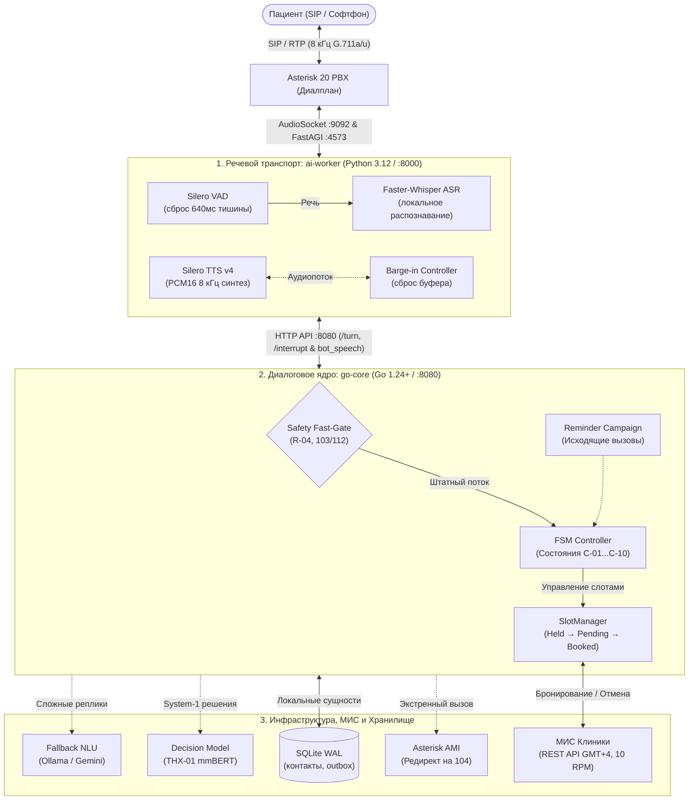

# Tochka Voice — Голосовая регистратура поликлиники № 7

<p align="center">
  
  
  
  
  
  
  
  
  
  
</p>

Голосовой ассистент регистратуры для кейса DBI хакатона «Точка сборки»: полнодуплексные SIP-звонки через Asterisk, локальное распознавание и синтез речи, детерминированный конечный автомат (FSM) на Go, оптимизированный локальный decision-стек и надёжная интеграция с медицинской информационной системой (МИС).

Проект полностью автономен и развёрнут **on-premise внутри защищённого контура организации**. Межсервисные API зафиксированы в локальном периметре (loopback / внутренняя сеть) с Bearer-авторизацией. Аудиопоток и персональные медицинские данные не передаются во внешние облака. Без `MIS_API_TOKEN` используется изолированный локальный mock со встроенным хранилищем в SQLite (WAL); при передаче токена подключается защищённый HTTPS API стенда «Регистратура». Официальный лимит стенда составляет **10 запросов в минуту (10 RPM)** (`rate.Every(6*time.Second)`). Для предотвращения исчерпания квоты реализовано локальное кэширование: справочник врачей кэшируется в памяти с TTL 10 минут, контакты и журнал исходов сохраняются в локальном SQLite WAL, а при статусе HTTP 429 клиент уважает заголовок `Retry-After` и блокирует исходящие запросы.

---

## 🎯 Ключевые возможности

* **Надёжное управление диалогом:** единственный владелец состояния и мутаций — контроллер Go FSM. Пациентская речь считается недоверенным вводом; ни ASR-текст, ни сырой ответ LLM не могут напрямую изменить статус визита.
* **Строгое подтверждение операций:** бронирование, отмена и перенос требуют обязательного явного подтверждения («Да», «Подтверждаю», «Мне подходит»). Перенос обновляет существующий `visit_id` через `PATCH`, не создавая дублирующих талонов.
* **Неавторегрессионная Decision-модель (doofz/THX-01):** локальный System-1 классификатор на базе mmBERT в `ai-worker` для быстрой типизированной оценки без генерации токенов (Zero Output Tokens). Обрабатывает композитные реплики (согласие + попутный вопрос: *«Да, а где кабинет?»*), нормализует выбор слотов и отсекает ложные тревоги соматических метафор. Модель не авторизует мутации напрямую — контроллер FSM сохраняет строгий детерминированный контроль.
* **Спекулятивный параллельный NLU и CPU-оптимизация:** параллельный запуск System-1 и System-2 устраняет задержки последовательного fallback (время ответа NLU снижено до 350–750 мс). Тюнинг потоков PyTorch (`torch.set_num_threads(4)`) и fast-path извлечение сущностей ускоряют инференс на CPU в 3.2–3.5 раза без потери качества.
* **Детерминированная медицинская безопасность (Fast-Gate):** экстренные маркеры (боли в груди, удушье, инсульт) мгновенно перехватываются за `< 1 мс`. Пациент слышит директиву вызвать **103/112**, а канал через Asterisk AMI Redirect переключается на экстренную линию **104**.
* **Соблюдение регламента и врачебной тайны (152-ФЗ / R-04):** ассистент не выдумывает диагнозов и строго следует правилу «пациент называет себя первым» (входящий номер ANI не раскрывает ПДн без явной верификации). При вопросах о симптомах бот вежливо разъясняет границы компетенции и переводит звонок врачу или оператору.
* **Телефонный аудиотракт (G.711 / 8 кГц):** приём и отдача звука пакетами PCM16 8 кГц по 20 мс через Asterisk AudioSocket и FastAGI. Потоковый Silero VAD со сбросом рекуррентного контекста после 640 мс тишины и мгновенный Barge-in (сброс воспроизведения при перебивании).
* **Кампания исходящих напоминаний (С-10):** автоматический обзвон накануне приёма строго в разрешённые интервалы (будни 10:00–19:00, сб 10:00–15:00 GMT+4) с проверкой получателя и фиксацией статуса в комментарии МИС.
* **Шифрованные стенограммы (AES-256-GCM) и защита данных:** полная защита персональных данных пациентов. Аудиопоток не записывается на диск, технические журналы очищены от ПДн. Текстовые логи диалогов шифруются отдельным ключом с правами `0600` и очищаются по таймеру (хранение не более 24 часов).
* **Декларативное тестирование и LLM-симулятор:** 51 встроенный end-to-end сценарий в [`scripts/run_scenarios.py`](scripts/run_scenarios.py) и автономный симулятор пациентов [`scripts/user_sim.py`](scripts/user_sim.py) (Gemini Live / Ollama) с симуляцией телефонных искажений G.711.

---

## 🏗️ Архитектура системы

Пайплайн разделен на два ключевых сервиса: **`ai-worker`** (Python, медиапоток и нейросети) и **`go-core`** (Go, логика, FSM, МИС, безопасность).



---

## 📋 Реализованные сценарии регламента

| Код | Название сценария | Описание и логика обработки | Задержка |
| :---: | :--- | :--- | :--- |
| **С-01** | Первичная запись к врачу | Подбор свободных слотов в Excel/МИС, выбор времени, удержание слота (Hold 2 мин) и обязательное подтверждение. | Fast-Path (< 50 мс) |
| **С-02** | Запись к узкому специалисту | Проверка направления. Если направления нет — предложение записи к терапевту. | Fast-Path (< 50 мс) |
| **С-03** | Отмена записи | Идентификация пациента (ФИО + ДР), озвучивание визита, явный переспрос «Да/Нет» и освобождение слота в МИС. | Fast-Path (< 50 мс) |
| **С-04** | Перенос записи | Поиск активного талона, подбор нового слота и атомарный `PATCH /visits/{id}` без создания дубликата. | Fast-Path (< 50 мс) |
| **С-05** | Проверка статуса записи | Поиск активных визитов и озвучивание даты, времени, кабинета и врача. | Fast-Path (< 50 мс) |
| **С-06/07** | Расписание и справочник | Ответы по графику поликлиники, забору крови, порядку прикрепления и профилям врачей. | < 50 мс / FAQ |
| **С-08** | Вызов врача на дом | Опрос адреса и симптомов при высокой температуре $\to$ асинхронная очередь `/escalations`. | Fast-Path |
| **С-09** | Перевод на оператора | Триггеры «позовите человека», «оператор» или 2 подряд ошибки распознавания $\to$ перевод на номер `101`. | **< 1 мс** |
| **С-10** | Исходящее напоминание | Дозвон накануне приема в рабочие часы, проверка абонента («Это я»), подтверждение или отмена визита. | Фоновый планировщик |
| **R-01** | Экстренные состояния (Кат. А) | Триггеры «инфаркт», «острая боль в груди», «задыхается» $\to$ директива 103/112 и AMI-редирект на `104`. | **< 1 мс** |
| **R-04** | Отказ в медконсультации | Защита от постановки диагноза через бота $\to$ разъяснение границ и перевод на специалиста. | < 20 мс |

---

## 📁 Структура проекта

```
tochka-voice/
├── go-core/                 # Высокопроизводительное диалоговое ядро на Go (1.24+)
│   ├── cmd/
│   │   ├── server/          # Главный HTTP API сервер ядра (:8080)
│   │   ├── cli-test/        # Интерактивная текстовая консоль отладки FSM
│   │   └── transcripts/     # CLI для работы с шифрованными стенограммами (AES-256-GCM)
│   └── pkg/
│       ├── dialogue/        # FSM сценарии (C-01...C-10), словарный NLU и парсер слотов
│       ├── safety/          # Fast-Gate фильтр экстренных состояний (< 1 мс)
│       ├── slotmgr/         # Жизненный цикл слотов (held → pending → booked), локи
│       ├── campaign/        # Модуль исходящих кампаний напоминаний (С-10)
│       ├── escalation/      # Outbox очередь заявок сотрудникам (вызовы на дом, операторы)
│       ├── llmclient/       # Fallback NLU и System-1 Decision Client (THX-01 mmBERT)
│       ├── misclient/       # Клиент REST API МИС (лимит 10 RPM, кэш врачей 10 мин, пагинация)
│       ├── schedule/        # Загрузка и разбор расписания врачей из Excel (GMT+4)
│       └── storage/         # Хранилище SQLite с WAL, миграции и локальные контакты
│
├── ai-worker/               # Речевой транспорт и ML-модели (Python 3.12 / FastAPI)
│   ├── src/
│   │   ├── telephony.py     # FastAGI (:4573) и AudioSocket (:9092) серверы
│   │   ├── asr.py           # Потоковое распознавание Faster-Whisper (CUDA / CPU)
│   │   ├── tts.py           # Локальный синтез Silero TTS v4 (8 кГц PCM16)
│   │   ├── vad.py           # Потоковый Silero VAD (сброс после 640 мс тишины)
│   │   ├── decision.py      # System-1 Decision Engine (THX-01 CPU ~37 мс, warmup, RLCD)
│   │   └── diagnostics.py   # Метрики аудиосигнала, клиппинг и технические логи
│   ├── tests/               # Юнит-тесты телефонии, VAD и аудио-пайплайна
│   └── main.py              # Точка входа AI Worker (:8000)
│
├── asterisk/                # Конфигурационные файлы Asterisk PBX
│   ├── pjsip.conf           # SIP-транки и тестовые эндпоинты (200, 101, 104)
│   ├── extensions.conf      # Диалплан поликлиники (FastAGI, AudioSocket, очереди)
│   ├── manager.conf         # Настройки Asterisk Manager Interface (AMI)
│   └── audiosocket.conf     # Конфигурация драйвера AudioSocket
│
├── data/                    # Справочники, регламенты и сценарии
│   ├── scenarios_dataset.json # Декларативный датасет на 51 сквозной сценарий
│   ├── user_sim_goals.json  # 15 целей и персон для LLM User Simulator
│   ├── reglament.txt        # Официальный регламент поликлиники № 7
│   └── *.xlsx               # Организаторский файл расписания врачей
│
└── scripts/                 # Инструменты тестирования и симуляции
    ├── run_scenarios.py     # Декларативный раннер 51 сценария (текст / голос)
    ├── user_sim.py          # Автономный LLM User Simulator (Gemini Live / Ollama)
    ├── sip_smoke.py         # Сквозной тест голосового сценария через SIP Asterisk
    ├── sip_outbound_smoke.py# Тестирование исходящей кампании напоминаний
    ├── voice_dialogue.py    # Живой интерактивный разговор через микрофон
    └── client.py            # Утилита HTTP-взаимодействия с API ядра
```

---

## 🚀 Быстрый старт

### Системные требования
* **ОС:** Linux (Ubuntu 22.04+ / Debian / Arch).
* **Среда выполнения:** Go 1.24+, Python 3.12+ (пакетный менеджер `uv`), Docker Compose.
* **Аппаратные ресурсы:** NVIDIA GPU с поддержкой CUDA рекомендуется для минимальных задержек. На CPU система работает в штатном режиме (`DEVICE=auto`).
* **Аудиоинструменты:** `ffmpeg`, `alsa-utils` (`aplay`, `arecord`).

### 1. Клонирование и инициализация
```bash
git clone https://github.com/0himera/clinicalvoice.git
cd clinicalvoice

# Генерация .env с безопасными секретами и настройка Asterisk AMI
make setup

# Установка Python-зависимостей и локальных моделей через uv
make install

# Сборка бинарников Go ядра (server, cli-test, transcripts)
make build
```

### 2. Запуск инфраструктуры (Asterisk PBX)
```bash
make docker-up
```
Запустит изолированный контейнер Asterisk на loopback-интерфейсе с настроенными портами SIP (5060/udp), RTP (10000-10100/udp), FastAGI (4573) и AudioSocket (9092).

### 3. Запуск сервисов

**Терминал 1: Диалоговое ядро (Go Core)**
```bash
make run-core
```
Сервер запустится на порту `:8080`, загрузит расписание из Excel, инициализирует базу SQLite и активирует планировщик кампаний.

**Терминал 2: Речевой транспорт (AI Worker)**
```bash
make run-ai
```
Сервис загрузит Faster-Whisper, Silero VAD и Silero TTS, открыв порты FastAGI `:4573`, AudioSocket `:9092` и HTTP `:8000`.

Проверка готовности сервисов:
```bash
curl -fsS http://127.0.0.1:8080/healthz
curl -fsS http://127.0.0.1:8000/health
```

---

## 📞 Подключение через SIP-софтфон

Для совершения звонка используйте любой SIP-клиент (Baresip, Linphone, MicroSIP, Zoiper):
* **Сервер/Домен:** `127.0.0.1` (порт 5060, UDP)
* **Пользователь:** `200` (пароль `testpass`)
* **Номер для звонка:** `700` (голосовой ассистент поликлиники)

Для проверки сценариев перевода зарегистрируйте операторов в отдельных окнах:
* Регистраторы: `101`, `102` (пароль `operatorpass`).
* Экстренный пост: `104` (пароль `operatorpass`).

---

## 🧪 Тестирование и верификация

### 1. Комплексный прогон проверок (`make check`)
Запускает линтеры Go и Python, проверку форматирования, race-тесты ядра и pytest:
```bash
make check
```

### 2. Запуск 51 декларативного сценария (`make scenarios`)
Прогоняет полный датасет сквозных сценариев ([`data/scenarios_dataset.json`](data/scenarios_dataset.json)) на изолированном mock-сервере:
```bash
# Текстовый режим (высокая скорость)
make scenarios

# Сквозной голосовой режим через реальные TTS и ASR
make scenarios-voice
```

### 3. Автономный LLM User Simulator (`make sim`)
Запускает симулятор пациента на базе LLM (Gemini Live или локальная Gemma 4 через Ollama) с наложением телефонных искажений G.711 A-law:
```bash
# Запуск через локальную Ollama (без голоса, быстрая валидация)
make sim

# Полнодуплексный голосовой диалог через Gemini 3.8 Live (Speech-to-Speech)
make sim-live

# Непрерывный стресс-тест симулятора на 1 час со сбором аналитики
make sim-live-1h
```
Результаты сохраняются в живых отчетах: `var/user_sim_report.md` и `var/user_sim_report.json`.

### 4. SIP Smoke-тесты в реальном Asterisk (`make smoke`)
```bash
# Синтетический E2E тест через AudioSocket
make smoke

# Звонок через локальный софтфон Asterisk (номер 200)
ai-worker/.venv/bin/python scripts/sip_smoke.py

# Проверка исходящего обзвона (3 звонка: подтверждение, перенос, отмена)
MIS_API_TOKEN= ALLOW_DEMO_CALLS_OUTSIDE_WINDOW=true DATABASE_PATH=var/outbound-smoke.db make run-core
ai-worker/.venv/bin/python scripts/sip_outbound_smoke.py
```

### 5. Живой диалог через микрофон
```bash
make voice
```

---

## 🔒 Безопасность, изоляция данных и On-Premise контур (152-ФЗ)

1. **Изоляция в контуре и On-Premise архитектура:**
   * Все сервисы (`go-core`, `ai-worker`, Asterisk PBX, база SQLite) работают локально на собственных серверах организации без обязательного доступа к публичным облакам.
   * Межсервисные коммуникации (ядро `:8080`, воркер `:8000`, телефония FastAGI `:4573` и AudioSocket `:9092`) ограничены loopback-интерфейсом (`127.0.0.1`) или изолированным доверенным сетевым сегментом с обязательной Bearer-авторизацией (`CORE_API_TOKEN`, `AI_API_TOKEN`).
   * Адрес эндпоинта модели решений `DECISION_MODEL_URL` строго валидируется ядром на loopback (`127.0.0.1` / `localhost`) — отправка реплик на сторонние сетевые узлы блокируется на уровне конфигурации.
2. **Принцип «Пациент называет себя первым» (ANI Privacy):**
   * Согласно регламенту поликлиники и требованиям защиты персональных данных, входящий номер телефона (Caller ID / ANI) является вспомогательным техническим атрибутом.
   * Бот никогда не здоровается по имени первым и не разглашает информацию о существующих записях до тех пор, пока пациент явно не назовёт свои ФИО и дату рождения.
3. **Нулевая запись аудио (Zero Audio Recording):**
   * Телефонный аудиопоток G.711 обрабатывается исключительно в оперативной памяти (in-flight кольцевой буфер для VAD/ASR/TTS) и никогда не сохраняется на физический диск в виде аудиофайлов.
4. **Технические журналы без ПДн:**
   * Стандартные журналы (`var/log/core-events.jsonl` и `speech-events.jsonl`) содержат только структурированные технические события: UUID сессий, коды FSM-состояний, задержки компонентов, коды возврата и уровни аудиосигнала. Реплики, ФИО, адреса и даты рождения в технические логи категорически не попадают.
5. **Шифрование стенограмм AES-256-GCM (`TRANSCRIPT_LOGGING=true`):**
   * Для проведения контролируемого аудита качества диалогов предусмотрено защищённое хранилище текстовых стенограмм.
   * Каждая реплика шифруется по стандарту AES-256-GCM с использованием изолированного ключа с правами `0600` (`var/secrets/transcripts.key`), физически отделённого от каталога логов.
   * Политика короткого хранения: автоматическая ротация и безвозвратное удаление записей по истечении `TRANSCRIPT_RETENTION_HOURS` (от 1 до 24 часов).
   * Просмотр расшифрованных записей только для авторизованного администратора:
     ```bash
     make transcripts
     # или для конкретного звонка:
     ./go-core/bin/transcripts -call UUID -last 50
     ```
   * Автоматический фоновый таймер systemd для периодической очистки устаревших стенограмм:
     ```bash
     make retention-timer
     ```
6. **Детерминированный медицинский контур (R-04):**
   * Исключена генерация медицинских советов, диагнозов или схем лечения нейросетевыми моделями.
   * При жалобах на самочувствие и симптомы мгновенно срабатывает Fast-Gate (< 1 мс), переводящий звонок сотруднику регистратуры (101) или экстренному посту (104).

---

## ⚡ Оптимизация производительности и задержек

Архитектура оптимизирована для устойчивой работы на стандартном серверном CPU (от 4 vCPU) с обеспечением естественного темпа телефонного диалога без томительных пауз:

* **Спекулятивный параллельный NLU (Speculative Parallel Execution):**
  * Ядро Go параллельно запускает быстрый локальный классификатор System-1 (`THX-01`) и резервную System-2 (`gpt-oss-120b` / Ollama).
  * Если System-1 возвращает уверенный ответ (вероятность $\ge 0.88$ или однозначный выбор слота), ожидание медленной LLM мгновенно отменяется по контексту (`context.WithCancel`).
  * Это устраняет последовательную задержку fallback и сокращает время принятия решения до **350–750 мс** (вместо 2400+ мс при последовательном опросе).
* **Многопоточный тюнинг PyTorch на CPU:**
  * Инференс моделей в `ai-worker` сбалансирован под многоядерные процессоры через `torch.set_num_threads(4)` и `torch.set_num_interop_threads(1)` с поддержкой oneDNN.
  * Это исключило конкуренцию потоков OpenMP и ускорило прямые проходы нейросетей в **3.2–3.5 раза** на стандартных виртуальных машинах.
* **Fast-Path экстракция врачей (`_fast_doctor_excerpt`):**
  * Для частых сущностей (фамилии врачей поликлиники, базовые специальности терапевт/хирург/лор) задействован мгновенный поиск по локальному словарю клиники за $< 1$ мс.
  * Это исключает два избыточных прогона 22-слойного энкодера ModernBERT на стандартных репликах.
* **AOT-прогрев моделей (Warmup) без холодных стартов:**
  * При инициализации `ai-worker` производит предварительный прогон тензоров для батчей размера 1 и 2. Первый звонящий пациент не сталкивается со стартовой паузой инициализации PyTorch/CUDA.
* **Мгновенный Barge-in и адаптивный VAD:**
  * Рекуррентный контекст Silero VAD отслеживает паузы речи (таймаут тишины 640 мс).
  * При обнаружении перебивания бот за миллисекунды очищает буфер воспроизведения AudioSocket и возвращает микрофон абоненту.

---

## ⚙️ Переменные конфигурации (.env)

| Переменная | По умолчанию | Назначение |
| :--- | :---: | :--- |
| **`PORT`** | `8080` | Порт HTTP API сервера Go Core |
| **`CORE_URL`** | `http://127.0.0.1:8080` | URL Go Core для AI Worker |
| **`CORE_API_TOKEN`** | — | Токен авторизации HTTP API Go Core |
| **`DATABASE_PATH`** | `var/tochka.db` | Путь к файлу SQLite базы данных (WAL) |
| **`SCHEDULE_PATH`** | `data/` | Путь к Excel-файлу организаторов с расписанием врачей |
| **`MIS_API_TOKEN`** | — | Токен доступа к HTTPS API стенда МИС (пусто = локальный mock) |
| **`MIS_API_URL`** | `https://crm-med-mock.dbi-testing.ru/api/v1` | Базовый адрес стенда МИС |
| **`DECISION_MODEL_ENABLED`** | `true` | Включение локальной System-1 Decision-модели (THX-01) |
| **`DECISION_MODEL_URL`** | `http://127.0.0.1:8000/v1/decide` | URL эндпоинта решений на AI Worker (строго loopback) |
| **`DECISION_DEVICE`** | `cpu` | Устройство инференса для Decision-модели (`cpu`, `cuda`, `auto`) |
| **`DECISION_MODEL_PATH`** | `doofz/THX-01` | Идентификатор или локальный путь к весам THX-01 |
| **`DECISION_MOCK`** | `false` | Режим семантического мока без загрузки нейросетевых весов |
| **`AI_WORKER_URL`** | `http://127.0.0.1:8000` | URL речевого транспорта для Go Core |
| **`AI_API_TOKEN`** | — | Bearer-токен для защиты эндпоинтов AI Worker (/asr, /tts, /v1/decide) |
| **`LLM_PROVIDER`** | `none` | Провайдер Fallback NLU (`none`, `ollama`, `gemini`) |
| **`LLM_MODEL`** | `gemma4:e4b` | Модель для NLU (`gemma4:e4b` / `gemini-3.5-flash-lite`) |
| **`LLM_ALLOW_REMOTE`** | `false` | Разрешение обращений к внешнему Gemini API |
| **`LLM_API_KEY`** | — | Ключ Google Gemini / OpenAI |
| **`DEVICE`** | `auto` | Устройство для нейросетей ASR/TTS (`auto`, `cuda`, `cpu`) |
| **`TTS_SPEAKER`** | `kseniya` | Голос синтеза речи в Silero TTS (`kseniya`, `baya`) |
| **`ASTERISK_AMI_ADDRESS`** | `127.0.0.1:5038` | Адрес подключения к Asterisk AMI |
| **`TRANSCRIPT_LOGGING`** | `false` | Включение защищённого сохранения стенограмм |
| **`TRANSCRIPT_RETENTION_HOURS`** | `24` | Срок хранения зашифрованных стенограмм (1–24 ч) |

---

## 📚 Документация и регламенты

* [**Архитектура и границы компонентов**](docs/architecture.md) — инварианты, управление квотами, жизненный цикл слотов и отказоустойчивость.
* [**Матрица приёмки и требования кейса**](docs/acceptance.md) — соответствие сценариям организаторов и протоколы проверок.
* [**Спецификация HTTP API**](docs/api.md) — форматы запросов `/turn`, `/interrupt`, структуры данных и коды ответов.
* [**Руководство для разработчиков**](AGENTS.md) — правила модификации кода, инварианты и регламенты верификации.

> [!NOTE]
> Заявленные в кейсе KPI являются целевыми показателями бизнес-регламента. `/api/stats` возвращает реальные локальные измерения по задержкам и исходам диалогов. Аудиозапись звонков по умолчанию отключена.
