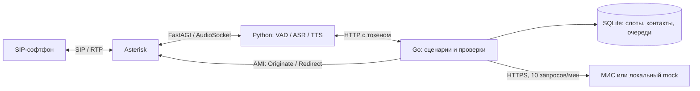

# Tochka Voice

Голосовая регистратура для кейса DBI хакатона «Точка сборки»: SIP-звонки через Asterisk, локальные распознавание и синтез речи, проверяемые операции с записями в МИС.

Проект работает без внешней LLM. Без `MIS_API_TOKEN` используется локальный mock с сохранением данных в SQLite; с токеном — HTTPS API стенда «Регистратура». В стенд вносятся только вымышленные данные.

## Что работает

- Запись с идентификацией, выбором времени и явным подтверждением.
- Перенос существующего визита через `PATCH`, без создания второго талона; отмена с освобождением локального слота.
- Выбор нужного визита при нескольких записях, проверка статуса, справочные ответы по регламенту.
- Уточнения «зачем?» и «повторите», справочный вопрос посреди записи и возврат к текущему шагу без потери данных.
- Вызов врача на дом: адрес и причина направляются сотруднику через очередь `/escalations`.
- Прерывание любого сценария красным флагом или просьбой позвать человека. Сначала произносится предупреждение, сохранение заявки не ждёт квоты МИС.
- Напоминания с проверкой получателя, согласием на обзвон, подтверждением, переносом и отменой. Подтверждение сохраняется комментарием `Подтверждена запись #<id> ДД.ММ.ГГГГ ЧЧ:ММ`.
- Двустороннее телефонное аудио 8 кГц, VAD, прерывание речи ассистента, ограничение длительности и обработка тишины.

SMS и лабораторные статусы не имитируются. По анализам ассистент сообщает нормативный срок и способы получения результата. Проверки направления, полномочий представителя и другие сведения, отсутствующие в контракте стенда, передаются сотруднику.

## Архитектура



Телефонный тракт использует AudioSocket, FastAGI и AMI. Неиспользуемые NATS и ARI удалены. Распознавание и синтез обрабатывают аудио локально; в МИС отправляются только данные операции. Для сложных формулировок доступен резервный NLU через Gemini API или локальный совместимый сервис. LLM возвращает структурированные намерения и сущности, не генерирует медицинские ответы и не выполняет операции с МИС.

## Запуск

Нужны Linux, GNU Make, Go 1.27+, Docker Compose, `uv` и Python 3.12. GPU необязателен: `DEVICE=auto` выбирает CUDA при наличии, иначе CPU. Для диагностики SIP нужен `ffmpeg`, для микрофона — `alsa-utils`.

```bash
git clone https://github.com/0himera/clinicalvoice.git
cd clinicalvoice
make setup             # .env с новыми секретами и конфигурация AMI
make install           # зависимости из uv.lock, включая модели и инструменты проверок
make docker-up         # Asterisk на loopback-интерфейсе
make run-core          # отдельный терминал, :8080
make run-ai            # отдельный терминал, :8000; FastAGI :4573, AudioSocket :9092
```

Первый запуск загружает модели. Код Silero и стандартная ASR-модель привязаны к ревизиям; для офлайн-стенда модели нужно предварительно закэшировать. Все команды запускаются из корня репозитория. Оба сервиса читают `.env`; переменные процесса имеют приоритет. Секреты и рабочие базы исключены из Git.

`make setup` создаёт `.env`, если файла ещё нет; повторный запуск сохраняет его значения и обновляет конфигурацию AMI. Перед звонком дождитесь готовности обоих сервисов:

```bash
curl -fsS http://127.0.0.1:8080/healthz
curl -fsS http://127.0.0.1:8000/health
```

В SIP-софтфоне (Baresip, Linphone, Zoiper): сервер `127.0.0.1`, пользователь `200`, пароль `testpass`, транспорт UDP. Наберите `700`. Это локальная тестовая учётная запись. Регистраторы — `101`, `102`, `104`, `105`, пароль `operatorpass`. Для приёма перевода соответствующий операторский софтфон должен быть запущен и зарегистрирован на АТС. Экстренный сценарий рекомендует внешние номера **103/112**, а внутренний перевод выполняется на **104**; реальный вызов скорой проект не имитирует.

### Расписание

`SCHEDULE_PATH` указывает на Excel организаторов. Если он пуст, выбирается единственный `.xlsx` в `data/`. Загружаются листы «Врачи», «Слоты» и «Календарь»: 85 врачей, 40 профилей, 136 973 слота, период 25.06–31.12.2026. Доступны только слоты со статусом «Свободен», с учётом локальных блокировок и записей МИС. На сегодня действует запас 30 минут; горизонт — 14 календарных дней.

Excel-ID не отправляются в стенд: при подключении МИС врачи сопоставляются по уникальному ФИО и профилю. Несовпадение останавливает запуск. Даты интерпретируются в GMT+4, независимо от часового пояса компьютера. После окончания периода нужен новый файл; расписание автоматически не выдумывается.

### Стенд МИС

В `.env` заполните `MIS_API_TOKEN`, выберите отдельный `DATABASE_PATH=var/stand.db`, установите `DEBUG_DIALOGUE=false` и `ALLOW_DEMO_CALLS_OUTSIDE_WINDOW=false`. Перезапустите ядро и речевой сервис, чтобы оба процесса перечитали настройки. Текстовая отладка и обход часов обзвона разрешены только с mock-МИС. База привязана к режиму и команде: mock-контакты не переносятся в другую МИС автоматически. Контракт: [OpenAPI стенда](https://crm-med-mock.dbi-testing.ru/docs/openapi.json). Клиент поддерживает пагинацию, кэш врачей, общий лимит 10 запросов в минуту и `Retry-After`. Неизвестный исход изменения не повторяется автоматически.

Для звонков по публичной сети нужен отдельно настроенный SIP-транк. Входящий номер или существующий IVR подключается к контексту `voice-inbound`; проект не требует замены всей IVR.

### Резервное понимание через Gemini

По умолчанию `LLM_PROVIDER=none`. Для явно разрешённой отправки сложных реплик в Gemini задайте `LLM_PROVIDER=gemini`, `LLM_ALLOW_REMOTE=true`, `LLM_MODEL=gemini-3.5-flash-lite`, `LLM_API_KEY` и перезапустите ядро. `GEMINI_API_KEY` также поддерживается. Официальный HTTPS-адрес выбирается автоматически, `LLM_BASE_URL` можно оставить пустым. Ключ не пишется в логи.

Быстрые правила работают первыми. Неоднозначные намерения, специальности и данные идентификации передаются NLU; отправляется только текущая текстовая реплика и название состояния. Аудио, карточки МИС и история звонка не передаются. При таймауте или невалидном JSON ассистент просит уточнение. Подтверждения записи и отмены обрабатываются ядром без LLM. Список врачей и ответы по регламенту строятся из локальных источников; модель не выдумывает их. В отладочной трассе видны `llm_used`, `nlu_intent`, задержка и ошибка NLU.

Контроллер отличает просьбу выполнить действие от вопроса о нём и учитывает отрицания. «Да, зачем подтверждать?» не оформляет запись. Вопрос о выборе врача получает утверждённое предложение первичного приёма, без подбора специальности по диагнозу. Последний вопрос бота хранится только внутри сессии для повтора и возврата к незавершённому шагу.

## Проверка

```bash
make check             # Go vet, race-тесты, Ruff, Python-тесты; модели не загружаются
```

Для голосовых проверок нужны установленные модели и работающий речевой сервис. Запустите ядро на порту 8080 с отдельной mock-базой; обычный экземпляр ядра на этом порту должен быть остановлен:

```bash
# Отдельный терминал; используйте новую базу для независимого прогона.
MIS_API_TOKEN= DATABASE_PATH=var/smoke.db make run-core
# Другой терминал из корня проекта:
make smoke             # настоящие TTS → ASR → запись → перенос → отмена
ai-worker/.venv/bin/python scripts/sip_smoke.py
```

Последняя команда регистрирует диагностический SIP-телефон на **локальном** номере 200 и прогоняет голосовой сценарий через реальный Asterisk. Не запускайте диагностический телефон одновременно с вашим софтфоном под номером 200. Автоматические голосовые прогоны используют синтетическую речь и вымышленных пациентов; аудио остаётся в памяти.

`scripts/sip_handoff_smoke.py` аналогично проверяет настоящий перевод на тестового регистратора 101 и дежурного сотрудника 104. Все диагностические телефоны регистрируются только на loopback; публичные номера не набираются.

Исходящий тест:

```bash
# Ядро в отдельном терминале; разрешение действует только для явного mock-демо.
MIS_API_TOKEN= ALLOW_DEMO_CALLS_OUTSIDE_WINDOW=true DATABASE_PATH=var/outbound-smoke.db make run-core
ai-worker/.venv/bin/python scripts/sip_outbound_smoke.py
```

Он проверяет три настоящих исходящих SIP-звонка: подтверждение, перенос, отмену. Планировщик всегда соблюдает часы обзвона; переопределение разрешает только ручной mock-вызов и запрещено с токеном стенда. Для отдельного визита: `scripts/trigger_asterisk_call.sh VISIT_ID`. Контакт и согласие должны быть сохранены заранее.

Быстрая текстовая проверка того же HTTP API: `./go-core/bin/cli-test`. `make voice` — вспомогательная диагностика микрофона; она не заменяет SIP-демо.

Сложный диалог с проверкой записей после каждой реплики:

```bash
# Отдельный терминал: новая mock-база, отдельный порт, без исходящих звонков.
PORT=8081 DATABASE_PATH=var/complex-smoke.db MIS_API_TOKEN= ASTERISK_AMI_SECRET= make run-core
# Текстовый прогон; --voice добавляет настоящие локальные TTS/ASR.
CORE_URL=http://127.0.0.1:8081 ai-worker/.venv/bin/python scripts/test_complex_dialogue.py
```

Используйте пустую базу для каждого прогона. Флаг `--require-nlu` добавляет проверки включённого NLU; он требует явно настроенного провайдера. Проверка включает повторные уточнения, справку во время подтверждения, запись, перенос того же ID и отмену. Набор Go-тестов также проверяет отрицания, несколько задач, смену пациента, ошибки NLU и прерывания безопасности.

Короткие ответы в телефонном потоке проверяет `ai-worker/.venv/bin/python scripts/test_vad_stream.py`: 48 сочетаний фразы и смещения аудиокадров после длинных пауз, с настоящим VAD и G.711. Нужны установленное окружение моделей, `ffmpeg` и запущенный речевой сервис; аудио не сохраняется.

Для локальной отладки живой речи установите `DEBUG_DIALOGUE=true` в `.env` и перезапустите оба сервиса. `tail -F var/debug/speech.jsonl var/debug/core.jsonl` покажет распознанный текст, ответы, переходы состояний, причину перевода и задержки с общим `call_id`. Этот режим пишет текст разговора в закрытые локальные файлы и доступен только с mock-МИС. Аудио не сохраняется. После проверки верните `DEBUG_DIALOGUE=false` и перезапустите сервисы. Путь можно изменить через `DEBUG_LOG_DIR`.

## Контракты и эксплуатация

- [HTTP API и конфигурация](docs/api.md)
- [Инварианты, отказоустойчивость и границы](docs/architecture.md)
- [Уточнения организаторов и матрица проверок](docs/acceptance.md)
- [Инструкции для работы с кодом](AGENTS.md)

Заявленные в кейсе KPI — целевые бизнес-показатели, а не результаты этого прототипа. `/api/stats` возвращает измеренные локальные исходы; снижение неявок и пропущенных звонков требует пилота. Сертификация ИСПДн и подключение промышленной МИС в эту реализацию не входят. Автоматические тесты HTTP-адаптера используют локальный сервер. С токеном команды дополнительно проверены внешний справочник, запись, перенос того же ID и отмена через HTTP-диалог с вымышленным пациентом. Результаты и ограничения описаны в матрице приёмки; голосовые проверки проводились с mock-МИС.
