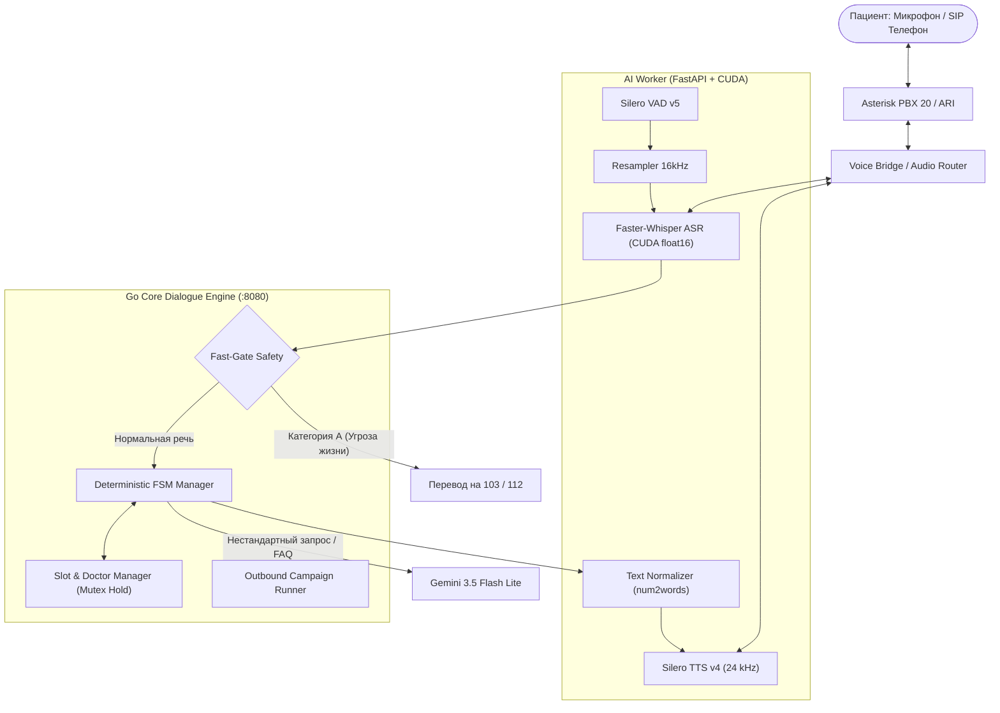

# 🏥 Tochka Voice — Голосовой ассистент поликлиники № 7

[](https://golang.org)
[](https://python.org)
[](https://developer.nvidia.com/cuda-toolkit)
[](https://github.com/SYSTRAN/faster-whisper)
[-blue)](https://github.com/snakers4/silero-models)
[](https://ai.google.dev/)
[](https://docker.com)

**Tochka Voice** — промышленный голосовой робот-ассистент для регистратуры городской поликлиники № 7. Система автоматизирует приём входящих звонков, запись на приём, проверку статуса, перенос/отмену визитов, ответы на частые вопросы по регламенту работы лаборатории и процедурных кабинетов, а также выполняет исходящий предиктивный автообзвон для подтверждения визитов.

---

## 🎯 Ключевые цели и показатели (KPI)

* **Снижение пропущенных звонков (< 15%):** параллельная обработка входящих SIP/PJSIP линий в Asterisk через связку NATS JetStream и Go Core 24/7.
* **Снижение доли неявок пациентов (No-Show < 12%):** модуль исходящих напоминаний накануне приёма (С-10) с соблюдением интервалов тишины (строго с 10:00 до 19:00 по будням и с 10:00 до 15:00 в субботу).
* **Мгновенный Fast-Path (< 150 мс):** детерминированный конечный автомат (FSM) на Go отвечает на типовые сценарии и подтверждения слотов за **1–2 мс**.
* **100% медицинская безопасность:** модуль **Fast-Gate** перехватывает экстренные состояния (Категория А: боли в сердце, кровотечения, одышка, травмы) за `< 1 мс` и мгновенно переводит звонок на скорую помощь (`103` / `112`), минуя длительные LLM-запросы.
* **Студийное качество речи (24 кГц):** переход с узкополосного телефонного аудио на 24 000 Гц в Silero TTS v4 с автоматической грамматической нормализацией падежей времени, дат и чисел.

---

## 🏗️ Архитектура системы

Пайплайн построен по гибридной схеме: **детерминированный Fast-Path (Go)** для мгновенного ответа и **асинхронный Slow-Path (LLM)** для нестандартных свободных формулировок и FAQ.



---

## 📋 Реализованные сценарии регламента

| Код | Название сценария | Логика обработки | Задержка |
| :---: | :--- | :--- | :---: |
| **С-01** | Первичная запись к терапевту/педиатру | Прямая запись без направления, поиск свободных слотов в МИС | Fast-Path (< 150 мс) |
| **С-02** | Запись к узким специалистам | Валидация направления. Если направления нет — предложение записи к терапевту | Fast-Path (< 150 мс) |
| **С-03** | Отмена записи | Идентификация пациента (ФИО + ДР), освобождение слота в МИС | Fast-Path (< 150 мс) |
| **С-04** | Перенос записи | Отмена старого слота и подбор альтернативного времени | Fast-Path (< 150 мс) |
| **С-05** | Проверка статуса записи | Поиск активных талонов и озвучивание даты, времени и кабинета | Fast-Path (< 150 мс) |
| **С-06/07** | График работы, забор крови, анализы | Базовый график поликлиники (Fast-path) или развернутый FAQ через LLM | 150 мс – 1.1 с |
| **С-08** | Вызов врача на дом | Опрос симптомов (температура, мобильность), фиксация адреса | Гибрид |
| **С-09** | Перевод на оператора (R-02) | Триггеры «позови человека», «оператор» или 2 подряд ошибки распознавания | < 1 мс |
| **С-10** | Исходящее напоминание о визите | Автоматический дозвон, подтверждение («Да») или отмена слота | Фоновый планировщик |
| **R-01** | Экстренные состояния (Категория А) | Триггеры «инфаркт», «задыхается», «острая боль» — перевод на 103/112 | **< 1 мс** |

---

## ⚡ Производительность и бенчмарки

### 1. Задержка сквозного диалога Голос-в-Голос (RTX 3070 GPU)

Реальные измерения на сквозном тесте `scripts/test_voice_simulation.py`:

```
=================================================================
 АВТОМАТИЧЕСКАЯ ВЕРИФИКАЦИЯ ПАЙПЛАЙНА ГОЛОС-В-ГОЛОС 
=================================================================
[БОТ ПРИВЕТСТВИЕ]: "Здравствуйте! Регистратура поликлиники номер семь..."
  -> TTS Синтез: 376844 байт аудио (24 кГц)

--- Реплика 1 (График работы - Fast-Path) ---
[ASR Распознано]:  129 мс ("Здравствуйте подскажите график работы Поликлиники.")
[FSM Решение]:     1 мс   (Fast-path Regex/FSM)
[TTS Синтез]:      13 мс  (Silero 24 кГц)
>> E2E Задержка:   143 мс

--- Реплика 2 (Забор крови в процедурном - Slow-Path LLM) ---
[ASR Распознано]:  110 мс ("А со скольки забор крови в процедурном?")
[FSM + Gemini]:    1013 мс (Gemini 3.5 Flash Lite FAQ)
[TTS Синтез]:      50 мс  (Silero 24 кГц, нормализация времени)
>> E2E Задержка:   1173 мс

--- Реплика 3 (Запись к терапевту - Fast-Path) ---
[ASR Распознано]:  138 мс ("Запишите меня к терапевту, я Иванов...")
[FSM Решение]:     2 мс
[TTS Синтез]:      12 мс
>> E2E Задержка:   152 мс

--- Реплика 4 (Завершение разговора) ---
[ASR Распознано]:  69 мс  ("Спасибо, до свидания.")
[FSM Решение]:     1 мс   (STATE_DONE)
[TTS Синтез]:      11 мс
>> E2E Задержка:   81 мс
```

### 2. Сравнение LLM-моделей (Бенчмарк `scripts/benchmark_gemini.py`)

| Модель | Средний TTFT | Полный ответ | Ошибки / 503 | Статус |
| :--- | :---: | :---: | :---: | :---: |
| **Gemini 3.5 Flash Lite** | **880–970 мс** | **900–1140 мс** | **0% (Стабильно)** | ✅ **Выбрана по умолчанию** |
| Gemini 3.1 Flash Lite | 5300–9500 мс | 6000–11000 мс | > 50% (HTTP 503) | ❌ Нестабильна |

---

## 📁 Структура репозитория

```
tochka-voice/
├── Makefile                 # Команды сборки, запуска, тестирования и очистки
├── docker-compose.yml       # Контейнеры Asterisk PBX и NATS JetStream
├── .env.example             # Пример конфигурации всех сервисов и ключей
├── .gitignore               # Исключение артефактов, venv, кэша и тяжелых wav
│
├── ai-worker/               # Python микросервис обработки аудио (CUDA / PyTorch)
│   ├── main.py              # Точка входа сервиса
│   ├── pyproject.toml       # Зависимости uv (Faster-Whisper, Silero, FastAPI)
│   ├── README.md            # Техническая документация AI-Worker
│   └── src/
│       ├── asr_service.py   # Faster-Whisper ASR с авто-ресемплингом в 16 кГц
│       ├── tts_service.py   # Silero TTS v4 на частоте 24 кГц
│       ├── normalizer.py    # Текстовый нормализатор числительных, дат и времени
│       ├── vad_service.py   # Silero VAD детектор активности голоса
│       └── voice_bridge.py  # FastAPI HTTP/Stream шлюз (:8000)
│
├── go-core/                 # Высокопроизводительное диалоговое ядро на Go
│   ├── cmd/
│   │   ├── server/main.go   # HTTP API сервер диалога, кампаний и метрик (:8080)
│   │   └── cli-test/main.go # Интерактивная консольная отладка FSM
│   └── pkg/
│       ├── dialogue/        # FSM сценарии (C-01...C-10) и текстовый парсер
│       ├── safety/          # Fast-Gate фильтр экстренных состояний (< 1 мс)
│       ├── slotmgr/         # Менеджер врачей, сетки расписания и блокировок
│       ├── campaign/        # Модуль исходящих подтверждений визитов (С-10)
│       ├── llmclient/       # Универсальный клиент LLM (Gemini 3.5 / OpenAI)
│       ├── misclient/       # Клиент медицинской информационной системы (МИС)
│       └── models/          # Доменные структуры данных
│
├── asterisk/                # Конфигурационные файлы Asterisk PBX
│   ├── pjsip.conf           # Настройки SIP транков и эндпоинтов
│   ├── extensions.conf      # Диалплан поликлиники (входящие, перевод на 101/103)
│   ├── ari.conf             # Доступ к Asterisk REST Interface
│   ├── rtp.conf             # Диапазон портов голосового RTP-трафика
│   └── http.conf            # Внутренний веб-сервер Asterisk
│
├── scripts/                 # Утилиты тестирования и бенчмаркинга
│   ├── test_voice_simulation.py # Автоматический сквозной тест Голос-в-Голос
│   ├── voice_dialogue.py        # Живой диалог через реальный микрофон и динамики
│   ├── benchmark_gemini.py      # Сравнение задержек LLM моделей
│   ├── trigger_asterisk_call.sh # Инициация тестового звонка через Call-файл
│   └── test_wav_dialogue.py     # Обработка готового аудиофайла
│
├── data/                    # Исходные регламенты и справочники
│   ├── task.txt             # Техническое задание кейса
│   ├── reglament.txt        # Официальный регламент регистратуры поликлиники № 7
│   ├── 21de07bd-...csv      # Датасет журнала звонков поликлиники
│   └── 30aef650-...csv      # Датасет расписания и записей пациентов
│
└── audio_output/            # Директория сгенерированных аудиозаписей диалога
    ├── .gitkeep
    └── full_dialogue.wav    # Пример полной записи разговора (24 кГц, WAV)
```

---

## 🚀 Быстрый старт

### Требования
* **ОС:** Linux (Ubuntu 22.04+ / Arch / Debian).
* **Go:** 1.22+
* **Python:** 3.12+ (рекомендуется пакетный менеджер `uv`).
* **GPU:** NVIDIA GPU с поддержкой CUDA (RTX 20xx/30xx/40xx) для задержек `< 150 мс`. На CPU система также работает (задержка ASR составит ~600–900 мс).
* **Инструменты:** `docker`, `docker-compose`, `alsa-utils` (`aplay`, `arecord`).

### 1. Клонирование и настройка окружения
```bash
git clone https://github.com/himera/tochka-voice.git
cd tochka-voice

# Создайте файл переменных окружения из шаблона
cp .env.example .env
```
В файле `.env` при необходимости укажите ваш `LLM_API_KEY` для Google Gemini.

### 2. Запуск инфраструктуры (Asterisk + NATS)
```bash
make docker-up
```

### 3. Сборка Go Core
```bash
make build
```

### 4. Запуск AI Worker
В отдельном терминале запустите AI-сервис распознавания и синтеза:
```bash
make run-ai
```
Сервис загрузит Faster-Whisper и Silero TTS на GPU и станет доступен на порту `8000`.

### 5. Запуск Go Core Сервера
В отдельном терминале запустите диалоговый сервер:
```bash
make run-core
```
Сервер запустится на порту `8080`, инициализирует базу из 25 врачей и активирует модуль исходящих звонков.

---

## 🧪 Тестирование и верификация

### Автоматическая симуляция диалога Голос-в-Голос
Прогоняет полный цикл реального диалога без необходимости использовать микрофон:
```bash
make test-sim
```
* Генерирует реплики пациента голосом `baya`.
* Распознает через Faster-Whisper.
* Прогоняет через FSM и Gemini 3.5.
* Синтезирует ответ голосом `kseniya` (24 кГц).
* Склеивает и сохраняет полную аудиозапись разговора в `audio_output/full_dialogue.wav`.

**Как прослушать результат:**
```bash
mpv audio_output/full_dialogue.wav
# или
aplay audio_output/full_dialogue.wav
```

### Интерактивный диалог через микрофон (Voice-to-Voice)
Позволяет поговорить с роботом вживую своим голосом:
```bash
make test-mic
```
* Нажмите `Enter` и говорите в микрофон фразы:
  * *«Здравствуйте, подскажите график работы поликлиники?»*
  * *«А со скольки забор крови в процедурном кабинете?»*
  * *«Запишите меня к терапевту, я Иванов Иван Иванович 15 апреля 1985 года»*
  * *«Спасибо, до свидания»*

### Запуск юнит-тестов
```bash
make test-unit
```
Проверяет логику FSM, работу Fast-Gate безопасности (Категория А/Б), мьютексы SlotManager на предотвращение гонок слотов и парсер дат/ФИО.

---

## ⚙️ Переменные конфигурации (.env)

| Переменная | По умолчанию | Описание |
| :--- | :---: | :--- |
| `LLM_PROVIDER` | `gemini` | Провайдер LLM (`gemini`, `openai`, `custom`) |
| `LLM_MODEL` | `gemini-3.5-flash-lite` | Модель для NLU и FAQ |
| `LLM_API_KEY` | — | API-ключ Google Gemini / OpenAI |
| `PORT` | `8080` | Порт HTTP API сервера Go Core |
| `NATS_URL` | `nats://localhost:4222` | Адрес брокера NATS JetStream |
| `AI_WORKER_HOST` | `0.0.0.0` | Хост для запуска FastAPI AI Worker |
| `AI_WORKER_PORT` | `8000` | Порт FastAPI AI Worker |
| `DEVICE` | `cuda` | Устройство для нейросетей (`cuda` или `cpu`) |
| `TTS_SPEAKER` | `kseniya` | Голос ассистента в Silero TTS (`kseniya`, `baya`) |
| `TTS_SAMPLE_RATE` | `24000` | Частота дискретизации синтеза речи (Гц) |
| `ASTERISK_ARI_URL` | `http://localhost:8088/ari` | Эндпоинт Asterisk REST Interface |
